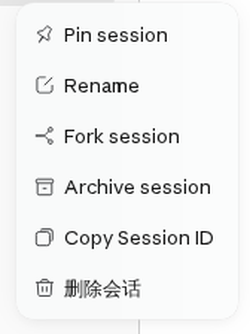
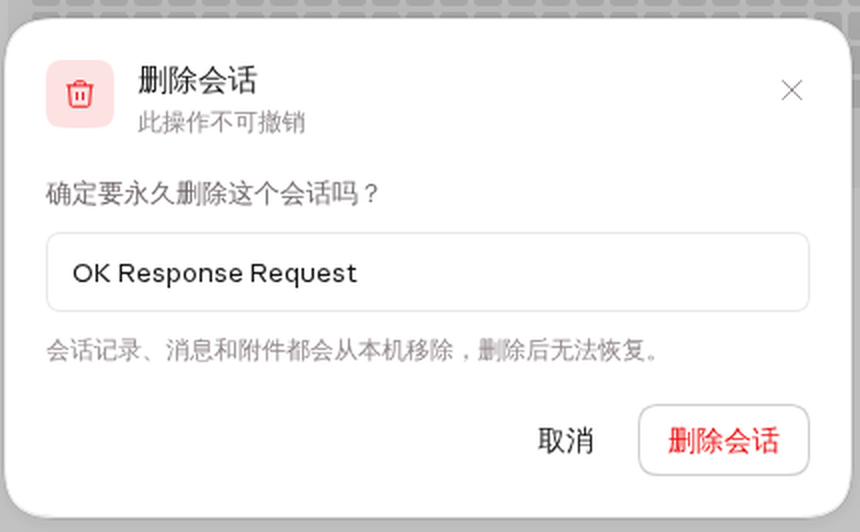
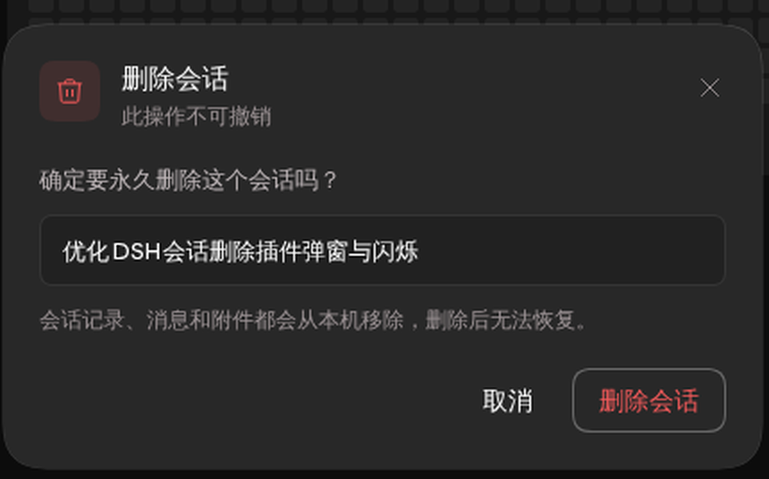

# Session Delete pour DSH

Supprimez **définitivement** une session DeepSeek Harness (dsh) depuis la barre latérale — avec une vraie boîte de confirmation et sans rechargement de page.

[English](README.md) | [中文](README.zh.md) | Français

DSH fournit *archiver*, pas *supprimer*. Ce plugin comble ce manque : il retire l'enregistrement de la session, la détache de tous les espaces de travail, ferme tout descripteur ouvert et supprime le dossier de journaux sur disque.



## Fonctionnalités

- Entrée **Supprimer la session** dans le menu contextuel d'une session de la barre latérale, juste après les actions natives.
- Une fenêtre de confirmation dans le langage visuel de Claude / OpenCode, construite à partir de la primitive `Modal` et des design tokens de DSH :
  - thèmes clair et sombre ;
  - action dangereuse en rouge, titre de la session, mention « action irréversible » ;
  - `Échap`, clic sur l'arrière-plan et bouton de fermeture explicite ;
  - message d'erreur affiché dans la fenêtre lorsque l'hôte refuse la requête ;
  - état occupé pendant la requête.
- **Aucun rechargement de page.** Après une suppression réussie, la barre latérale se rafraîchit sur place via `sessions.refresh()`.
- **Supprimer la session active** vide la vue principale, conserve l'espace de travail sélectionné et revient à l'accueil. Supprimer une session en arrière-plan laisse la vue courante intacte.
- **Supprimer un espace de travail avec ses sessions.** Lorsqu'un espace de travail possède encore des sessions, sa suppression ouvre une confirmation en cascade affichant le nombre de sessions. Confirmer supprime définitivement toutes les sessions de cet espace, puis retire l'enregistrement de l'espace. Le dossier sur disque est conservé.
- L'hôte diffuse `api-session/removed`, donc les autres onglets ouverts retirent aussi la ligne.

| Clair | Sombre |
| --- | --- |
|  |  |

## Installation

```sh
# depuis npm (une fois publié)
dsh plugin add dsh-plugin-session-delete

# directement depuis GitHub
dsh plugin add github:wooxi/dsh-session-delete
```

Redémarrez le service web DSH après l'installation. Le paquet déclare un patch `dsh.bundle` et fournit `client.js` déjà compilé : aucune étape de build ni autorisation de build n'est nécessaire.

Pour désinstaller :

```sh
dsh plugin remove dsh-plugin-session-delete
```

## Compatibilité

- DSH `>=0.2.1-rc.1 <0.3.0-0`
- Client web uniquement (`dsh.client.platform: "web"`)
- Node.js `>=20`

## Langues

Le texte des fenêtres n'est pas codé en dur : le plugin enregistre un espace de noms `sessionDelete` auprès du service de localisation du client DSH et le déclare sur les slots qu'il possède. Chaque libellé suit donc la langue choisie dans **Paramètres → Général** et bascule sans rechargement.

| Langue | Couverture |
| --- | --- |
| `zh` | Complète |
| `en` | Complète |
| `fr` | Complète |
| autres | Repli sur l'anglais |

## Fonctionnement

**Hôte** (`index.js`) enregistre `POST /api/dsh/session-delete`. La route :

1. valide l'identifiant de session (`/^session-[A-Za-z0-9._-]+$/`) et confirme que la session existe ;
2. si la session est active, la détache du contrôleur de sessions — ce qui ferme les descripteurs d'écriture et émet `session/disposed`, afin que le cache de projection et l'index de recherche suivent ;
3. détache l'identifiant de tous les espaces de travail qui le référencent, et efface l'état d'archivage / d'épinglage ;
4. supprime le dossier de journaux de la session sous la racine des sessions dsh — le chemin résolu est vérifié pour rester dans cette racine ;
5. reconstruit l'index d'en-têtes des sessions stockées et émet `api-session/removed`.

**Client** (`src/client.jsx`) ajoute l'élément de menu et affiche la fenêtre via le slot `shell.overlay`. Le menu se ferme avant l'ouverture de la fenêtre, qui appartient donc à l'overlay et survit au démontage du menu. Après une suppression réussie, il appelle `ctx.sessions.refresh()`, puis conserve l'espace de travail (via `uiWorkspace.openWorkspace`) ou vide la vue principale. Les textes proviennent de `src/locales.js` et arrivent aux composants par le seat `t` que le framework injecte dans les slots déclarant une locale.

La suppression d'un espace de travail enveloppe `ctx.workspaces.delete`. Lorsque l'espace possède encore des sessions, l'enveloppe ouvre une confirmation en cascade avant que la suppression officielle ne s'exécute. Confirmer supprime chaque session via la même route hôte, rafraîchit la liste des sessions, puis appelle le `workspaces.delete` d'origine — le dossier reste en place tandis que les sessions, elles, disparaissent.

## Sécurité et données

- La suppression est **définitive** : les messages, les métadonnées de pièces jointes et le dossier de journaux de la session sont retirés de cette machine.
- La route n'accepte que `POST`, en même origine, et s'appuie sur l'authentification par cookie déjà en place. Aucun jeton n'est stocké par le plugin.
- Les identifiants de session sont validés avant toute construction de chemin, et le chemin de suppression doit rester sous la racine des sessions.
- Le plugin n'effectue aucune requête réseau.

## Développement

```sh
npm install
npm run build
```

`npm run build` regroupe `src/client.jsx` (et son import `src/locales.js`) dans l'enveloppe de module navigateur attendue par dsh (`client.js`). Le point d'entrée hôte est du ESM simple et n'est pas regroupé.

## Licence

MIT
