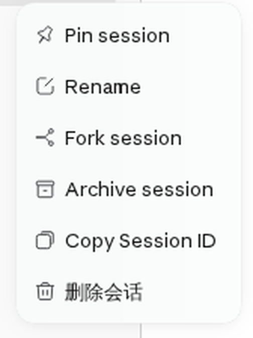
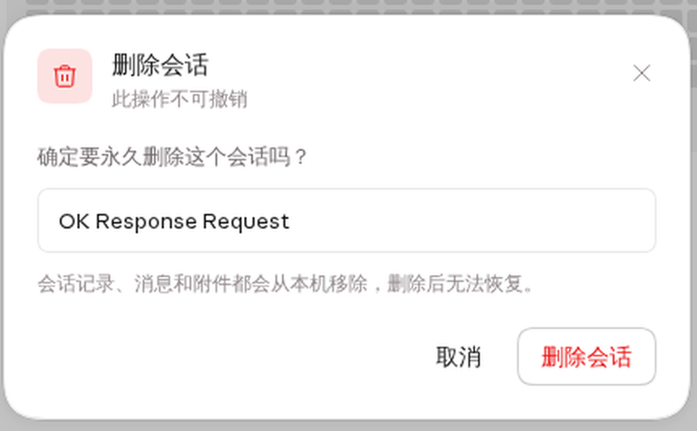
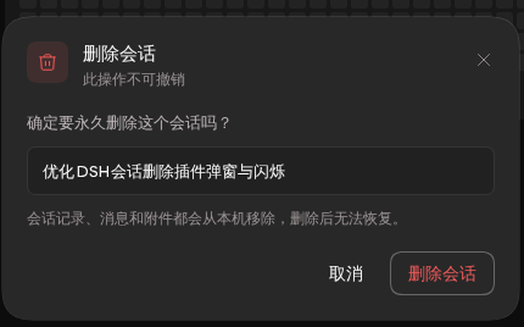

# DSH 会话删除插件

在 DeepSeek Harness（dsh）侧栏中**永久删除**会话：带完整的确认弹窗，删除后不整页刷新。

DSH 官方只提供「归档」，没有「删除」。本插件补上这一环：移除会话记录、从所有工作区解绑、关闭 live 句柄，并删除磁盘上的会话日志目录。



## 功能

- 侧栏会话菜单新增「删除会话」，排在内置操作之后。
- Claude / OpenCode 风格的确认弹窗（基于 DSH `Modal` primitive 与设计 token）：
  - 浅色 / 深色主题自适应。
  - 红色危险操作、会话标题、「不可撤销」说明。
  - 支持 `Esc`、点击遮罩、关闭按钮。
  - 请求失败时在弹窗内显示错误，不弹浏览器原生 alert。
  - 删除进行中显示忙碌状态。
- **不整页刷新**：删除成功后通过 `sessions.refresh()` 就地刷新侧栏。
- **删除当前会话**：清空主视图、保留工作区选择、回到首页；删除后台会话时当前视图不受影响。
- host 会广播 `api-session/removed`，其它已打开的标签页也会移除该行。

| 浅色 | 深色 |
| --- | --- |
|  |  |

## 安装

```sh
# 从 npm 安装（发布后）
dsh plugin add dsh-plugin-session-delete

# 直接从 GitHub 安装
dsh plugin add github:wooxi/dsh-session-delete
```

安装后重启 DSH Web 服务。包内已声明 `dsh.bundle` patch，并预构建了 `client.js`，无需再执行构建，也无需构建授权。

卸载：

```sh
dsh plugin remove dsh-plugin-session-delete
```

## 兼容性

- DSH `>=0.2.1-rc.1 <0.3.0-0`
- 仅 Web 客户端（`dsh.client.platform: "web"`）
- Node.js `>=20`

## 实现说明

**Host**（`index.js`）注册 `POST /api/dsh/session-delete`：

1. 校验会话 id（`/^session-[A-Za-z0-9._-]+$/`）并确认会话存在。
2. 若会话处于 live 状态，从 session controller 摘除——关闭写句柄并发出 `session/disposed`，projection 缓存与搜索索引随之更新。
3. 从所有引用该会话的工作区中解绑，并清除归档 / 置顶状态。
4. 删除 dsh sessions 根目录下的会话日志目录；删除前校验解析后的路径仍在根目录内。
5. 重建会话 header 索引，并广播 `api-session/removed`。

**Client**（`src/client.jsx`）注册菜单项，并通过 `shell.overlay` slot 渲染弹窗。菜单项会在弹窗打开前关闭，弹窗由 overlay 持有，因此不受菜单卸载影响。删除成功后调用 `ctx.sessions.refresh()`，再根据情况通过 `uiWorkspace.openWorkspace` 保留工作区，或清空主视图。

## 安全与数据

- 删除是**永久性**的：消息、附件元数据和会话日志目录都会从本机移除。
- 路由仅接受 `POST`、同源请求，复用宿主现有的 Cookie 认证；插件不保存任何 token。
- 创建路径前先校验会话 id，删除路径必须位于 sessions 根目录内。
- 插件不发起任何网络请求。

## 开发

```sh
npm install
npm run build
```

`npm run build` 会把 `src/client.jsx` 打包成 dsh 浏览器模块所需的 envelope（`client.js`）。host 入口是普通 ESM，不参与打包。

## License

MIT
